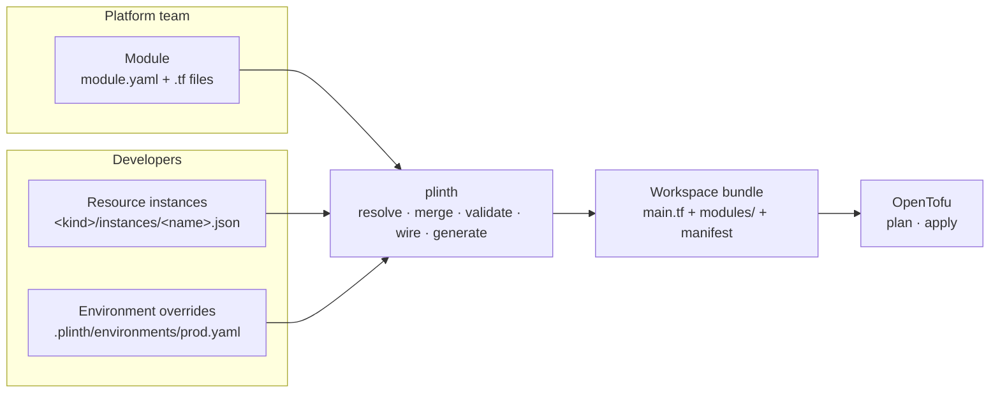

# Plinth

**Infrastructure abstraction and governed releases on top of OpenTofu.**

Platform engineers publish reusable infrastructure **modules**. Application
developers compose them into a **blueprint** by writing small JSON files, with no
HCL, providers or state files to manage. Plinth specializes the blueprint for each
**environment**, validates everything up front, and generates a plain, deterministic
OpenTofu workspace.

OpenTofu still does the real work against your cloud, and your state stays in your
own backend. You can always take the generated OpenTofu and run it without Plinth.

> **Status: Phase 0 (engine proof).** The core engine works end to end on local
> catalogs: validate, merge, wire, generate and apply with OpenTofu. There is no
> server, UI, or release workflow yet. See [Status](#status).

---

## Why

Without Plinth, every team that needs infrastructure writes or copies Terraform:
wiring module outputs into inputs by hand, keeping `dev`/`staging`/`prod` tfvars in
sync, and finding mistakes only when `apply` fails.

With Plinth:

| | Without Plinth | With Plinth |
| --- | --- | --- |
| Who writes OpenTofu | Every team, for every service | The platform team, once per capability |
| A new service | A few hundred lines of HCL | One ~15-line JSON file |
| Per-environment differences | Full copies of tfvars | Sparse overrides of only what changes |
| Wiring module A into module B | Hand-written `module.a.output` lines | Generated from typed inputs and outputs |
| A wrong wire | Found at `apply`, maybe never | Rejected before any OpenTofu runs |

---

## How it works



### Core concepts

| Concept | What it is |
| --- | --- |
| **Catalog** | A versioned folder of modules owned by a platform team. |
| **Module** | A reusable capability: OpenTofu code plus a contract (`module.yaml`), identified by **kind** / **flavor** / **version**, e.g. `kubernetes_cluster/aws_eks/1.0`. |
| **Blueprint** | The set of resource instances and their connections, shared by all environments. |
| **Resource instance** | One configured use of a module, addressed `<kind>/<name>`, e.g. `application/checkout-api`. |
| **Input / Output** | Modules declare typed inputs and outputs. An input connects only to an output of the same **output type**, written `<catalog>/<name>`, e.g. `core/kubernetes_cluster`. |
| **Environment** | Sparse overrides on top of the blueprint: change a spec value, or disable an instance. Environments never add instances. |
| **Workspace bundle** | The generated OpenTofu root, copies of every module it uses, and a manifest of module digests. The same inputs always produce byte-identical output. |

---

## Quickstart

Requirements: [mise](https://mise.jdx.dev) (installs the pinned Go and OpenTofu versions).

```bash
git clone https://github.com/Dhananjay-JSR/Plinth.git
cd Plinth
mise install                       # Go and OpenTofu, versions from mise.toml

# Validate the example blueprint for the prod environment
mise exec -- go run ./cmd/plinth validate -blueprint testdata/blueprints/checkout -env prod

# Generate the OpenTofu workspace bundle
mise exec -- go run ./cmd/plinth render -blueprint testdata/blueprints/checkout -env prod -out /tmp/checkout-prod

# Apply it with plain OpenTofu (the example modules use terraform_data: no cloud, no cost)
mise exec -- tofu -chdir=/tmp/checkout-prod init
mise exec -- tofu -chdir=/tmp/checkout-prod apply
```

---

## A blueprint on disk

```text
checkout/
├── blueprint.yaml                          # marks the blueprint root
├── kubernetes_cluster/instances/default.json
├── application/instances/checkout-api.json
└── .plinth/
    ├── project.yaml                        # which catalogs this project uses
    └── environments/
        ├── dev.yaml
        └── prod.yaml
```

**A resource instance** (`application/instances/checkout-api.json`):

```json
{
  "kind": "application",
  "flavor": "fake",
  "version": "1.0",
  "inputs": {
    "kubernetes_details": { "kind": "kubernetes_cluster", "name": "default" }
  },
  "spec": {
    "image": "checkout-api:v1.4",
    "port": 8080,
    "replicas": 2,
    "env": {
      "CLUSTER": "${kubernetes_cluster.default.out.default.attributes.cluster_name}"
    }
  }
}
```

- `inputs` connects the `kubernetes_details` input to the cluster instance. Plinth
  checks that the cluster produces the output type the input needs.
- `${<kind>.<name>.out.<output>.<path>}` references another instance's output from
  inside a spec.

**An environment** (`.plinth/environments/prod.yaml`):

```yaml
overrides:
  application/checkout-api:
    spec:
      replicas: 5
  # network/nat:
  #   disabled: true
```

Overrides merge recursively: objects merge, while arrays, scalars and `null` replace.

**The project** (`.plinth/project.yaml`):

```yaml
catalogs:
  core: ../../catalogs/core     # catalog name → local folder
```

---

## Writing a module

A module lives in a catalog at `modules/<kind>/<flavor>/<version>/`:

```text
modules/application/fake/1.0/
├── module.yaml      # the contract
├── variables.tf     # instance, instance_name, environment, inputs
└── main.tf          # ordinary OpenTofu
```

```yaml
# module.yaml
kind: application
flavor: fake
version: "1.0"
spec:                              # JSON Schema; validates each instance's spec
  type: object
  required: [image, port]
  properties:
    image: { type: string }
    port:  { type: integer, minimum: 1, maximum: 65535 }
inputs:
  kubernetes_details: { type: core/kubernetes_cluster }
  cache:              { type: core/redis, optional: true }   # null when not connected
outputs:
  default: { type: core/application }
```

Every module receives the same four variables:

| Variable | Contains |
| --- | --- |
| `instance` | `kind`, `flavor`, `version` and the effective `spec` |
| `instance_name` | The instance's name, e.g. `checkout-api` |
| `environment` | The environment, currently `{ name }` |
| `inputs` | The connected producers' outputs, keyed by input name (`null` for unconnected optional inputs) |

---

## What Plinth checks before any OpenTofu runs

- The spec matches the module's JSON Schema.
- Every required input is connected, and only declared inputs are used.
- Each input is connected to an output of the same output type.
- References point at existing, enabled instances and declared outputs.
- No instance depends on one that is disabled in this environment.
- Environments only override instances that exist in the blueprint.
- The dependency graph has no cycles.

All problems are reported together, not one at a time.

---

## Status

**Works today (Phase 0)**

- [x] Module contracts with JSON Schema spec validation
- [x] Local catalogs with content digests pinned in the manifest
- [x] Environment overrides and disabled instances
- [x] Typed input wiring and output references
- [x] Deterministic workspace generation
- [x] `plinth validate` and `plinth render`
- [x] End-to-end test with real OpenTofu: apply, clean re-plan, in-place environment change

**Not yet**

- [ ] Git-based catalogs and version pinning by ref
- [ ] Variables, artifacts and secret references
- [ ] Provider configuration from module outputs, and bootstrap waves
- [ ] `plinth plan`, `apply`, `destroy` and `export`
- [ ] Releases, policy gates, approvals and drift detection
- [ ] Server, UI and runners

---

## Development

```bash
mise exec -- go test ./...                          # all tests, including the OpenTofu end-to-end test
mise exec -- go test ./internal/generate -update    # regenerate golden files after an intended output change
```

| Path | Purpose |
| --- | --- |
| `cmd/plinth` | CLI |
| `internal/module` | Module contract parsing and spec validation |
| `internal/catalog` | Module resolution and content digests |
| `internal/merge` | Override merge rules |
| `internal/blueprint` | Loading, input wiring, references, graph checks |
| `internal/generate` | Workspace bundle generation |
| `testdata/` | Example catalog, blueprint and golden output |

## Principles

- **Not a new IaC engine.** OpenTofu plans and applies.
- **No lock-in.** The output is plain OpenTofu, and state lives in your backend.
- **Not cloud magic.** Provider differences stay explicit in modules.
- **Safety isn't UI-only.** Every rule is enforced by the engine and tested.
