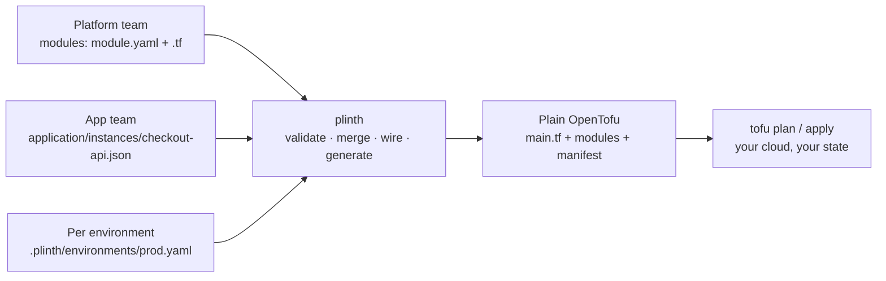

# Plinth

**Describe infrastructure in a few lines of JSON. Get plain OpenTofu out.**

A platform team writes infrastructure once, as reusable modules. Every
application team then asks for what it needs (a cluster, a database, a
deployment) in a short JSON file, without writing HCL, wiring module outputs by
hand, or keeping per-environment tfvars in sync.

`plinth` checks the request, applies each environment's differences, and
generates an ordinary OpenTofu workspace. OpenTofu does the rest, against your
cloud and your state.

```console
$ plinth render -env prod -out build/prod
prod: rendered 2 resource instances to build/prod
$ tofu -chdir=build/prod apply
```



## Install

```bash
curl -fsSL https://raw.githubusercontent.com/Dhananjay-JSR/Plinth/main/install.sh | sh
```

The installer downloads the release binary for your platform (macOS or Linux,
amd64 or arm64) and verifies it against the published `SHA256SUMS`. Or from
source:

```bash
go install github.com/Dhananjay-JSR/Plinth/cmd/plinth@latest
```

`plinth` generates OpenTofu, so you also need
[OpenTofu](https://opentofu.org/docs/intro/install/) to apply what it renders.

## Use

Take a checkout service that needs a Kubernetes cluster.

**The platform team writes a module once.** Its `module.yaml` is the contract:
what a team may configure, what the module needs, and what it provides.

```yaml
# catalog/modules/application/k8s_deployment/1.0/module.yaml
kind: application
flavor: k8s_deployment
version: "1.0"
spec:                                    # JSON Schema for what teams may set
  type: object
  required: [image, port]
  properties:
    image:    { type: string }
    port:     { type: integer, minimum: 1, maximum: 65535 }
    replicas: { type: integer, minimum: 1 }
inputs:
  kubernetes_details: { type: core/kubernetes_cluster }   # needs a cluster
outputs:
  default: { type: core/application }                    # provides an app
```

Next to it is ordinary OpenTofu (`main.tf`, `variables.tf`) that reads
`var.instance.spec`, `var.inputs` and `var.environment`.

**The checkout team asks for a deployment.** One file per resource, named by
where it lives: this one is `application/checkout-api`.

```json
// application/instances/checkout-api.json
{
  "kind": "application",
  "flavor": "k8s_deployment",
  "version": "1.0",
  "inputs": {
    "kubernetes_details": { "kind": "kubernetes_cluster", "name": "default" }
  },
  "spec": {
    "image": "checkout-api:v1.4",
    "port": 8080,
    "replicas": 2,
    "env": {
      "CLUSTER": "${kubernetes_cluster.default.out.default.attributes.cluster_name}"
    }
  }
}
```

`inputs` plugs in the cluster as a whole. Plinth checks it really is a cluster.
`${...}` copies a single value from another resource's output into a setting.

**Production only says what is different:**

```yaml
# .plinth/environments/prod.yaml
overrides:
  application/checkout-api:
    spec:
      replicas: 5
```

**Render it:**

```console
$ plinth validate -env prod
prod: 2 resource instances valid
$ plinth render -env prod -out build/prod
prod: rendered 2 resource instances to build/prod
```

`build/prod/main.tf` is the wiring you would otherwise write by hand:

```hcl
module "application__checkout-api" {
  source        = "./modules/application/k8s_deployment/1.0"
  instance_name = "checkout-api"
  instance = {
    "spec" = {
      "env" = {
        "CLUSTER" = "${module.kubernetes_cluster__default.default.attributes.cluster_name}"
      }
      "image"    = "checkout-api:v1.4"
      "port"     = 8080
      "replicas" = 5
    }
    # ...
  }
  inputs = {
    "kubernetes_details" = module.kubernetes_cluster__default.default
  }
}
```

The modules it uses are copied into `build/prod/modules/`, and
`.plinth/manifest.json` records a content digest for each, so the same inputs
always render the same bytes. It is a self-contained OpenTofu project:

```console
$ tofu -chdir=build/prod init
$ tofu -chdir=build/prod apply
```

**Mistakes stop before OpenTofu runs.** Disable the cluster in prod and pass
the port as a string, and every problem is reported at once:

```console
$ plinth validate -env prod
application/checkout-api: depends on kubernetes_cluster/default, which is disabled in environment prod
application/checkout-api: spec/port: got string, want integer
```

### Try it

The repository ships this example with simulated modules that use OpenTofu's
built-in `terraform_data`, so it applies with no cloud account and no cost:

```bash
git clone https://github.com/Dhananjay-JSR/Plinth.git && cd Plinth
plinth render -blueprint testdata/blueprints/checkout -env prod -out /tmp/checkout-prod
tofu -chdir=/tmp/checkout-prod init && tofu -chdir=/tmp/checkout-prod apply
```

## Commands

| Command | Does |
| --- | --- |
| `plinth validate -env <name>` | Check the blueprint for an environment; exit 1 on any problem |
| `plinth render -env <name> -out <dir>` | Write the OpenTofu workspace for an environment into an empty directory |
| `-blueprint <dir>` | Blueprint location (default: current directory) |
| `plinth --version` | Print the version |

## What plinth checks

Before writing any OpenTofu, for the chosen environment:

- each resource's `spec` matches its module's JSON Schema
- every required input is connected, and only to an output of the same type
- every `${...}` reference points at an existing, enabled resource and a declared output
- nothing depends on a resource disabled in this environment
- the environment only overrides resources that exist
- there are no dependency cycles

## Layout

```text
shopkart/                                   # a blueprint
├── blueprint.yaml
├── kubernetes_cluster/instances/default.json
├── application/instances/checkout-api.json
└── .plinth/
    ├── project.yaml                        # catalogs:  core: ../catalog
    └── environments/
        ├── dev.yaml
        └── prod.yaml

catalog/modules/<kind>/<flavor>/<version>/  # a module
├── module.yaml
├── variables.tf
└── main.tf
```

Environment overrides merge into the blueprint: objects merge key by key,
while lists, plain values and `null` replace. An override can also switch a
resource off with `disabled: true`. It can never add one.

Every module receives the same four variables:

| Variable | Holds |
| --- | --- |
| `instance` | `kind`, `flavor`, `version` and the merged `spec` |
| `instance_name` | The resource's name, e.g. `checkout-api` |
| `environment` | The environment, e.g. `{ name = "prod" }` |
| `inputs` | Each connected input's producer output, or `null` for an unconnected optional input |

## Development

```bash
mise install                                      # Go and OpenTofu at the pinned versions
mise exec -- go test ./...                        # includes an end-to-end OpenTofu apply
mise exec -- go test ./internal/generate -update  # refresh golden files after an intended output change
```

Releases are cut by pushing a `vX.Y.Z` tag.
