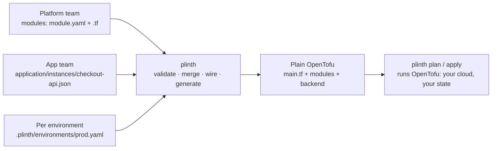

# Plinth

[](https://github.com/Dhananjay-JSR/Plinth/actions/workflows/ci.yml)
[](https://github.com/Dhananjay-JSR/Plinth/releases)
[](LICENSE)

**Describe infrastructure in a few lines of JSON. Get plain OpenTofu out.**

A platform team writes infrastructure once, as reusable modules. Every
application team then asks for what it needs (a cluster, a database, a
deployment) in a short JSON file, without writing HCL, wiring module outputs by
hand, or keeping per-environment tfvars in sync.

`plinth` checks the request, applies each environment's differences,
generates an ordinary OpenTofu workspace, and runs OpenTofu on it against your
cloud and your state.

```console
$ plinth apply -env prod
...
Plan: 2 to add, 0 to change, 0 to destroy.

Apply these changes to prod? Only 'yes' will be accepted: yes
Apply complete! Resources: 2 added, 0 changed, 0 destroyed.
```



## Install

```bash
curl -fsSL https://raw.githubusercontent.com/Dhananjay-JSR/Plinth/main/install.sh | sh
```

The installer downloads the release binary for your platform (macOS or Linux,
amd64 or arm64) and verifies it against the published `SHA256SUMS`. Or from
source:

```bash
go install github.com/Dhananjay-JSR/Plinth/cmd/plinth@latest
```

`plinth` runs [OpenTofu](https://opentofu.org/docs/intro/install/) 1.6 or newer,
found on your `PATH`.

## Use

Take a checkout service that needs a Kubernetes cluster.

**The platform team writes a module once.** Its `module.yaml` is the contract:
what a team may configure, what the module needs, and what it provides.

```yaml
# catalog/modules/application/k8s_deployment/1.0/module.yaml
kind: application
flavor: k8s_deployment
version: "1.0"
spec:                                    # JSON Schema for what teams may set
  type: object
  required: [image, port]
  properties:
    image:    { type: string }
    port:     { type: integer, minimum: 1, maximum: 65535 }
    replicas: { type: integer, minimum: 1 }
inputs:
  kubernetes_details: { type: core/kubernetes_cluster }   # needs a cluster
outputs:
  default: { type: core/application }                    # provides an app
```

Next to it is ordinary OpenTofu (`main.tf`) that reads `var.instance.spec`,
`var.inputs` and `var.environment`. Plinth declares those variables for every
module, so there is no `variables.tf` to write. Check a module on its own with
`plinth module validate <dir>`.

**The checkout team asks for a deployment.** One file per resource, named by
where it lives: this one is `application/checkout-api`.

```json
// application/instances/checkout-api.json
{
  "kind": "application",
  "flavor": "k8s_deployment",
  "version": "1.0",
  "inputs": {
    "kubernetes_details": { "kind": "kubernetes_cluster", "name": "default" }
  },
  "spec": {
    "image": "checkout-api:v1.4",
    "port": 8080,
    "replicas": 2,
    "env": {
      "CLUSTER": "${kubernetes_cluster.default.out.default.attributes.cluster_name}"
    }
  }
}
```

`inputs` plugs in the cluster as a whole. Plinth checks it really is a cluster.
`${...}` copies a single value from another resource's output into a setting.

**Production only says what is different:**

```yaml
# .plinth/environments/prod.yaml
overrides:
  application/checkout-api:
    spec:
      replicas: 5
```

**Apply it:**

```console
$ plinth validate -env prod
prod: 2 resource instances valid
$ plinth apply -env prod
```

`plinth apply` renders the environment into `.plinth/build/prod/`, runs
`tofu init` and `tofu plan`, and applies exactly the plan it showed you once you
type `yes`. Its `main.tf` is the wiring you would otherwise write by hand:

```hcl
module "application__checkout-api" {
  source        = "./modules/application/k8s_deployment/1.0"
  instance_name = "checkout-api"
  instance = {
    "spec" = {
      "env" = {
        "CLUSTER" = "${module.kubernetes_cluster__default.default.attributes.cluster_name}"
      }
      "image"    = "checkout-api:v1.4"
      "port"     = 8080
      "replicas" = 5
    }
    # ...
  }
  inputs = {
    "kubernetes_details" = module.kubernetes_cluster__default.default
  }
}
```

The modules it uses are copied alongside, and `.plinth/manifest.json` records
a content digest for each, so the same inputs always render the same bytes.

**State stays where you say.** By default it is a local file,
`.plinth/state/prod.tfstate`, kept out of git. To use a shared backend, name it
in the environment and Plinth writes the `backend` block:

```yaml
# .plinth/environments/prod.yaml
state:
  backend: s3
  config: { bucket: shopkart-tfstate, key: prod.tfstate, region: ap-south-1 }
```

**Review now, apply later.** A saved plan is only applied if nothing changed
since it was made:

```console
$ plinth plan -env prod -out prod.plan
$ plinth apply -env prod -plan prod.plan     # after review
```

If `prod.yaml`, an instance or a module changed in between, `apply` refuses and
asks you to plan again.

**Catch changes made outside Plinth.** `plinth drift` compares real
infrastructure with state without changing anything, and exits 2 if they differ.
Each change is listed under the resource's own address, and values OpenTofu
marks sensitive are never printed:

```console
$ plinth drift -env prod
~ application/checkout-api  terraform_data.deployment
    output.replicas: 5 → 12
- config_file/app-settings  local_file.this: deleted outside Plinth
prod has drifted: real infrastructure differs from its state.
```

**Take it with you.** `plinth render -env prod -out ./prod-tofu` writes the same
workspace to a folder of your choice: a plain OpenTofu project that runs without
Plinth.

**Mistakes stop before OpenTofu runs.** Disable the cluster in prod and pass
the port as a string, and every problem is reported at once:

```console
$ plinth validate -env prod
application/checkout-api: depends on kubernetes_cluster/default, which is disabled in environment prod
application/checkout-api: spec/port: got string, want integer
```

### Try it

The repository ships this example with simulated modules that use OpenTofu's
built-in `terraform_data`, so it applies with no cloud account and no cost:

```bash
git clone https://github.com/Dhananjay-JSR/Plinth.git && cd Plinth
plinth apply   -blueprint testdata/blueprints/checkout -env prod
plinth destroy -blueprint testdata/blueprints/checkout -env prod   # type "prod" to confirm
```

## Commands

| Command | Does |
| --- | --- |
| `plinth validate -env <name>` | Check the blueprint for an environment; exit 1 on any problem |
| `plinth plan -env <name> [-out <file>]` | Show what would change; `-out` saves the plan for later |
| `plinth apply -env <name>` | Plan, confirm with `yes`, apply that plan |
| `plinth apply -env <name> -plan <file>` | Apply a saved plan, refusing if anything changed since |
| `plinth destroy -env <name>` | Destroy everything in the environment; confirm by typing its name |
| `plinth drift -env <name>` | Report changes made outside Plinth; exit 2 if any |
| `plinth render -env <name> -out <dir>` | Write the OpenTofu workspace to an empty folder (export) |
| `plinth module validate <dir>` | Check a module's contract and OpenTofu code |
| `-blueprint <dir>` | Blueprint location (default: current directory) |
| `-auto-approve` | Skip the confirmation on `apply` and `destroy` |
| `plinth --version` | Print the version |

## What plinth checks

Before writing any OpenTofu, for the chosen environment:

- each resource's `spec` matches its module's JSON Schema
- every required input is connected, and only to an output of the same type
- every `${...}` reference points at an existing, enabled resource and a declared output
- nothing depends on a resource disabled in this environment
- the environment only overrides resources that exist
- there are no dependency cycles

## Layout

```text
shopkart/                                   # a blueprint
├── blueprint.yaml
├── kubernetes_cluster/instances/default.json
├── application/instances/checkout-api.json
└── .plinth/
    ├── project.yaml                        # catalogs:  core: ../catalog
    ├── environments/
    │   ├── dev.yaml
    │   └── prod.yaml
    ├── build/                              # generated workspaces (git-ignored)
    └── state/                              # default local state (git-ignored)

catalog/modules/<kind>/<flavor>/<version>/  # a module
├── module.yaml
└── main.tf
```

Environment overrides merge into the blueprint: objects merge key by key,
while lists, plain values and `null` replace. An override can also switch a
resource off with `disabled: true`. It can never add one.

Every module receives the same four variables, declared by Plinth:

| Variable | Holds |
| --- | --- |
| `instance` | `kind`, `flavor`, `version` and the merged `spec` |
| `instance_name` | The resource's name, e.g. `checkout-api` |
| `environment` | The environment, e.g. `{ name = "prod" }` |
| `inputs` | Each connected input's producer output, or `null` for an unconnected optional input |

## Development

```bash
mise install                                      # Go and OpenTofu at the pinned versions
mise exec -- go test ./...                        # includes an end-to-end OpenTofu apply
mise exec -- go test ./internal/generate -update  # refresh golden files after an intended output change
```

Releases are cut by pushing a `vX.Y.Z` tag.

## License

Apache-2.0. See [LICENSE](LICENSE).
